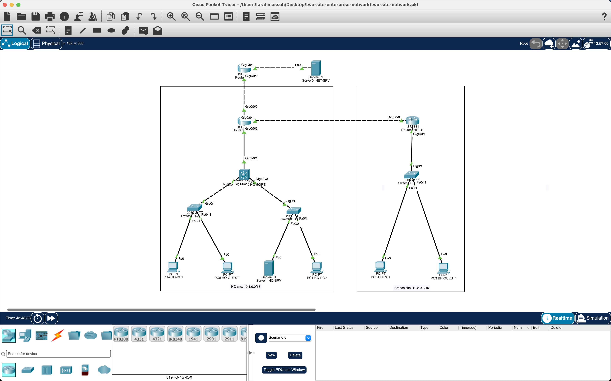

# Two-Site Enterprise Network

A two-site enterprise network (headquarters + branch office) designed, built and tested in Cisco Packet Tracer: VLANs, inter-VLAN routing (two methods), OSPF, centralized DHCP with relay, NAT/PAT, guest-isolation ACLs, SSH-only management, port security and a deterministic STP root.

**The design** (logical diagram):


**The build** (screenshot of the working network in Cisco Packet Tracer 9.0.1):



*Every link is up (green). The title bar shows `two-site-network.pkt`, the same file that is in this repository, open on the author's machine. The step-by-step [commit history](https://github.com/farahmassuh-ai/two-site-enterprise-network/commits/main) shows the network being built and tested over three days.*

---

## What this project demonstrates

| Area | Technologies |
|---|---|
| **Switching** | VLANs, 802.1Q trunks with allowed-VLAN lists, access ports with DTP disabled, access ports grouped in blocks per VLAN |
| **Routing** | Inter-VLAN routing with SVIs (Layer 3 switch) and router-on-a-stick, single-area OSPF, static default route |
| **Services** | Centralized DHCP with relay (`ip helper-address`) across the WAN, NAT/PAT to the internet |
| **Security** | Extended ACL isolating guest VLANs, SSH v2 only (Telnet refused), port security with sticky MACs, PortFast + BPDU Guard, unused ports shut down, hashed enable secrets |
| **Operations** | Management VLAN, STP root placement, verification with `show` commands and ping/TTL analysis, configs under version control |

---

## Topology

**14 devices, 13 links**, built on Cisco Packet Tracer 9.0.1.

| Device | Model | Role |
|---|---|---|
| ISP | ISR 4331 | Simulated internet provider |
| INET-SRV | Server-PT | Simulated internet server (198.51.100.10) |
| HQ-R1 | ISR 4331 | HQ edge router: NAT, DHCP server, OSPF, default route |
| BR-R1 | ISR 4331 | Branch router: router-on-a-stick, DHCP relay, OSPF |
| HQ-CORE | Catalyst 3650-24PS | HQ Layer 3 switch: SVIs, DHCP relay, OSPF, STP root |
| HQ-ACC1, HQ-ACC2 | Catalyst 2960-24TT | HQ access switches |
| BR-ACC1 | Catalyst 2960-24TT | Branch access switch |
| HQ-PC1, HQ-PC2, HQ-GUEST1, BR-PC1, BR-GUEST1 | PC-PT | End users (DHCP) |
| HQ-SRV | Server-PT | Internal server (static 10.1.30.10) |

### Physical links

| From | Port | To | Port | Type |
|---|---|---|---|---|
| ISP | Gi0/0/0 | HQ-R1 | Gi0/0/0 | Point-to-point /30 |
| ISP | Gi0/0/1 | INET-SRV | Fa0 | Server network /24 |
| HQ-R1 | Gi0/0/1 | BR-R1 | Gi0/0/0 | WAN point-to-point /30 |
| HQ-R1 | Gi0/0/2 | HQ-CORE | Gi1/0/1 | Point-to-point /30, routed port on HQ-CORE (GLC-T transceiver on HQ-R1) |
| HQ-CORE | Gi1/0/2 | HQ-ACC1 | Gi0/1 | 802.1Q trunk |
| HQ-CORE | Gi1/0/3 | HQ-ACC2 | Gi0/1 | 802.1Q trunk |
| BR-R1 | Gi0/0/1 | BR-ACC1 | Gi0/1 | 802.1Q trunk (router-on-a-stick) |
| HQ-ACC1 | Fa0/1, Fa0/11 | HQ-PC1, HQ-GUEST1 | Fa0 | Access |
| HQ-ACC2 | Fa0/1, Fa0/21 | HQ-PC2, HQ-SRV | Fa0 | Access |
| BR-ACC1 | Fa0/1, Fa0/11 | BR-PC1, BR-GUEST1 | Fa0 | Access |

---

## IP addressing plan

Each site gets its own /16, so the site is visible from the address alone (10.1.x.x = HQ, 10.2.x.x = branch). Public-facing addresses use RFC 5737 documentation ranges.

| Site | Network | Subnet | Gateway |
|---|---|---|---|
| HQ | VLAN 10 Staff | 10.1.10.0/24 | 10.1.10.1 (HQ-CORE) |
| HQ | VLAN 20 Guest | 10.1.20.0/24 | 10.1.20.1 (HQ-CORE) |
| HQ | VLAN 30 Servers | 10.1.30.0/24 | 10.1.30.1 (HQ-CORE) |
| HQ | VLAN 99 Management | 10.1.99.0/24 | 10.1.99.1 (HQ-CORE) |
| HQ | HQ-R1 ↔ HQ-CORE | 10.1.0.0/30 | .1 HQ-R1, .2 HQ-CORE |
| Branch | VLAN 10 Staff | 10.2.10.0/24 | 10.2.10.1 (BR-R1) |
| Branch | VLAN 20 Guest | 10.2.20.0/24 | 10.2.20.1 (BR-R1) |
| Branch | VLAN 99 Management | 10.2.99.0/24 | 10.2.99.1 (BR-R1) |
| WAN | HQ-R1 ↔ BR-R1 | 10.0.0.0/30 | .1 HQ-R1, .2 BR-R1 |
| Internet | HQ-R1 ↔ ISP | 203.0.113.0/30 | .1 ISP, .2 HQ-R1 |
| Internet | ISP ↔ INET-SRV | 198.51.100.0/24 | .1 ISP, .10 server |

**Access port blocks (all access switches):** Fa0/1–10 Staff, Fa0/11–20 Guest, Fa0/21–24 Servers (HQ only).
**Management addresses:** HQ-ACC1 10.1.99.11, HQ-ACC2 10.1.99.12, BR-ACC1 10.2.99.11.

---

## Design decisions

- **Two inter-VLAN routing methods, on purpose.** HQ uses SVIs on a Layer 3 switch, which scales and keeps inter-VLAN traffic inside the switch. The branch uses router-on-a-stick, which is cheaper for a small site but shares one link.
- **Hub design for the internet.** Only HQ-R1 connects to the ISP; the branch reaches the internet through HQ. One exit point is easier to secure and monitor.
- **OSPF internally, a default route externally.** OSPF runs only between the three internal routing devices (HQ-R1, BR-R1 and HQ-CORE), with `passive-interface default` so no OSPF hellos are sent on user VLANs. Internal routes are never shared with the ISP; HQ-R1 holds a static default route and advertises it with `default-information originate`.
- **Centralized DHCP.** All pools live on HQ-R1. Gateways forward client broadcasts with `ip helper-address`, so branch clients get addresses across the WAN. Addresses .1–.10 are excluded in every pool for gateways and static devices. Servers and management stay static.
- **Guest isolation close to the source.** The `GUEST-IN` extended ACL is applied inbound on both guest gateways: allow DHCP, deny anything going to 10.0.0.0/8, allow everything else (internet).
- **Layer 2 hardening.** Every access port has port security (1 MAC, sticky, violation restrict), PortFast and BPDU Guard. Every unused port is shut down. HQ-CORE is configured as STP root so the root bridge doesn't depend on MAC addresses.

---

## Verification

Every feature was tested after it was configured. TTL values prove the path: PCs start at 128 and each router hop subtracts 1.

| # | Test | Evidence | Result |
|---|---|---|---|
| 1 | HQ inter-VLAN routing (Staff → Servers) | HQ-PC1 → 10.1.30.10: replies, TTL 127 (1 hop) | ✅ |
| 2 | Branch router-on-a-stick (Staff → Guest) | BR-PC1 → BR-GUEST1: replies, TTL 127 (tested before the guest ACL was added) | ✅ |
| 3 | OSPF adjacencies | `show ip ospf neighbor` on HQ-R1: 2.2.2.2 and 3.3.3.3 both FULL | ✅ |
| 4 | OSPF routes | BR-R1 learned all 4 HQ /24s as `O` (cost 3) and `O*E2 0.0.0.0/0` | ✅ |
| 5 | Site to site | BR-PC1 → HQ-SRV: replies, TTL 125 (3 hops) | ✅ |
| 6 | DHCP with relay | `show ip dhcp binding`: 5 leases, each in the correct subnet from .11 | ✅ |
| 7 | Internet via PAT | HQ-PC1 and BR-PC1 → 198.51.100.10: TTL 125; `show ip nat statistics` showed 16 translations | ✅ |
| 8 | Guest isolation | Guests reach the internet; guests → HQ-SRV get "Destination host unreachable" from their gateway; staff still reach HQ-SRV; ACL deny line counted 4 matches | ✅ |
| 9 | SSH management | SSH logins from a Staff PC to all 6 managed devices, including across the WAN; `show ip ssh` = version 2.0 | ✅ |
| 10 | Port security | Sticky MACs learned (HQ-PC1 on HQ-ACC1 Fa0/1, HQ-SRV on HQ-ACC2 Fa0/21) | ✅ |
| 11 | STP root | `show spanning-tree vlan 10` on HQ-CORE: priority 24586, "This bridge is the root" | ✅ |
| 12 | Config audit | Exported configs checked port by port against the plan with a script | ✅ |

Troubleshooting notes from the build are in [docs/troubleshooting.md](docs/troubleshooting.md).

---

## Repository structure

```
├── README.md
├── two-site-network.pkt              # Packet Tracer file (9.0.1)
├── configs/                          # Exported config of every Cisco device
│   ├── ISP.txt
│   ├── HQ-R1.txt
│   ├── BR-R1.txt
│   ├── HQ-CORE.txt
│   ├── HQ-ACC1.txt
│   ├── HQ-ACC2.txt
│   └── BR-ACC1.txt
├── diagrams/
│   ├── topology.svg                  # Logical design
│   └── packet-tracer-topology.png    # Screenshot of the working build
└── docs/
    └── troubleshooting.md            # Problems found and how they were solved
```

---

## Running the lab

1. Open `two-site-network.pkt` in Cisco Packet Tracer 9.0.1 or later.
2. Lab-only credentials (practice values, not used anywhere else):
   - Console password: `cisco`
   - Enable secret: `class`
   - SSH: user `admin`, password `class`
3. From a PC's Command Prompt, try `ping 198.51.100.10` (internet) or `ssh -l admin 10.1.99.11` (management).

---

## Limitations and next steps

- **Simulation, not hardware.** Packet Tracer supports a subset of Cisco IOS; some commands differ on real devices.
- **No redundancy yet.** Single links and a single edge router. Next: redundant uplinks with EtherChannel and a first-hop redundancy protocol (HSRP).
- **Management could be tighter.** Next: restrict SSH to the management subnet with an `access-class` ACL, and add NTP, syslog and AAA.
- **IPv4 only.** Next: dual-stack IPv6.
- **Manual configuration.** Next project: automate configuration and verification with Python.

---

## About

Built while preparing for the Cisco CCNA, applying concepts from university coursework in computer and communication networks.
